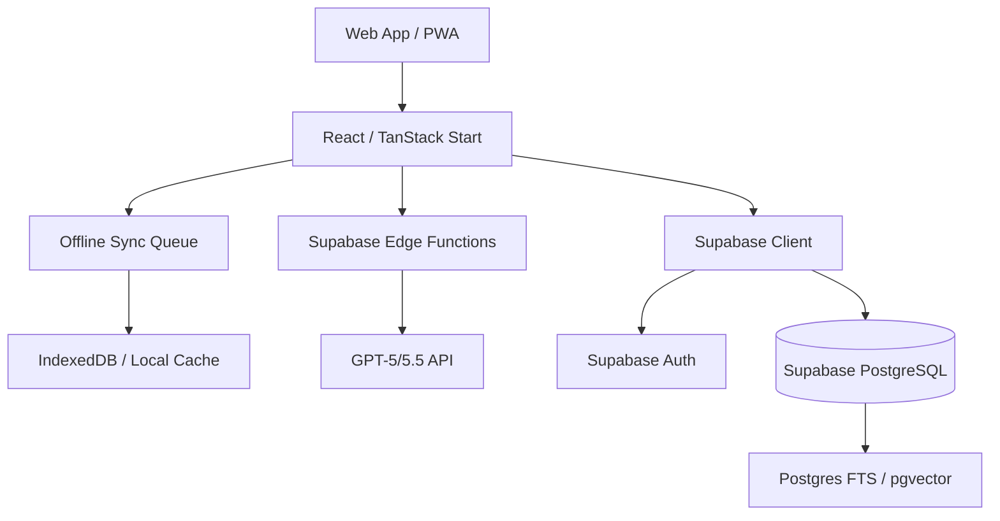

# Relationship OS
## Product Specification & Technical Architecture (React/PWA + Supabase Edition)

---

## 1. Product Vision

**Relationship OS** is a private, high-performance personal operating system designed to help users build, maintain, and strengthen the most important connections in their lives (family, friends, mentors, colleagues, clients, and partners).

Instead of treating people as sales targets like standard CRMs, Relationship OS centers on authentic connection. It is built as a web-first Progressive Web App (PWA) using React and TanStack Start, prioritizing speed, clean design, and data ownership.

### Core Pillars
1. **Linear/Notion-Level Aesthetic:** Keyboard-driven, zero clutter, high-density layouts, fluid page-level transitions, and beautiful custom dark modes.
2. **Speed & Offline Capability:** Sub-100ms client operations with optimistic UI updates and background synchronization queues.
3. **Serverless AI Core:** Prompt summaries, promise extraction, and meeting briefs processed securely via Supabase Edge Functions routing to LLMs (GPT-5/5.5). No local model downloads or heavy processing on-device.
4. **Data Ownership & Transparency:** Full-text search and vector indexes run in PostgreSQL on Supabase. Backups and exports are available to users at any time.

---

## 2. Market Analysis & Competitor Comparison

### Competitor Landscape & Weaknesses

| Competitor | Primary Use Case | Key Strengths | Core Weaknesses / Pain Points | Relationship OS Opportunity |
| :--- | :--- | :--- | :--- | :--- |
| **Clay** | Professional & personal networking | Rich web scrapers, integrations, clean design | High monthly subscription, web-wrapped iOS is slow, privacy concerns | **Modern PWA + Supabase:** High-performance React, single source of truth, secure authentication, and data ownership. |
| **Monica CRM** | Open-source personal CRM | Self-hosted, free | Clunky web UI, no mobile app, high data entry friction | **Auto-Capture & AI Summaries:** Quick pasting of meeting notes parsed into promises and summaries via AI. |
| **Dex** | Professional relationship manager | Browser extension, calendar sync, LinkedIn integration | Clunky UX, slow performance | **Notion-Level UX:** Clean features, keyboard shortcuts, fast navigation, and clear Relationship Strength metrics. |
| **Apple/Google Contacts** | System address book | Native system integration | Static, no interaction history, no search by traits | **PWA Extension:** Adds rich interaction history, markdown notes, promises, and communication cycles. |

---

## 3. User Personas

### Persona A: The High-Growth Entrepreneur & Investor (Alex, 34)
- **Role:** Venture Capitalist & Startup Mentor.
- **Pain Point:** Interacts with 50+ people weekly. Struggles to remember specific details (kids' names, startup ideas, past investments) before dinners.
- **Relationship OS Utility:** **Meeting Briefs** summarize the contact's details, past history, and promises on a single page before calendar events.

### Persona B: The Devoted Family Member & Friend (Sophia, 28)
- **Role:** Remote Software Engineer.
- **Pain Point:** Gets consumed by work and forgets to call parents regularly, miss anniversaries, or follow up on a friend's medical surgery.
- **Relationship OS Utility:** Sets "Stay in Touch Every" to 14 days for parents. The dashboard flags their decaying **Relationship Strength** and surfaces suggestion prompts.

---

## 4. MVP Scope Definition

To ensure rapid execution and maximum polish, the MVP focuses strictly on features that directly build stronger relationships:

### In MVP Scope (High-Priority)
- **Rich Contact Profiles:** Preferences, hobbies, and communication cycles.
- **Interaction History:** Date-logged notes, calls, SMS, and meetings.
- **Smart Reminders:** Anniversaries, custom cycles (Stay in Touch Every), and pending promises.
- **AI Meeting Briefs:** Summarizes the contact's details and active promises.
- **AI Follow-up Suggestions:** Automatically extracts follow-ups and promises from pasted meeting notes.
- **Relationship Strength Score:** Dynamic calculation based on frequency and promises.
- **Daily Dashboard:** Core views for today's agenda, birthdays, and overdue promises.
- **Fast Search:** PostgreSQL Full-Text Search.
- **Offline Sync Queue:** Optimistic local writes syncing back when online.
- **Data Export:** Export all data as JSON or CSV.

### Deferred (Phase 2 & Beyond)
- Gift tracker
- On-device speech-to-text / Voice memos
- Apple Watch application
- Chrome extension / LinkedIn sync

---

## 5. Technical Architecture

Relationship OS is built using a modern full-stack TypeScript architecture.



### Folder Structure
We organize the project using a feature-based structure to make development modular and scale cleanly:

```
src/
├── assets/             # Images, static media
├── components/         # Global shared components (Buttons, inputs, UI wrappers)
├── features/           # Feature-specific components, hooks, and services
│   ├── ai/             # AI prompt wrappers, edge function client calls
│   ├── analytics/      # Chart rendering, snapshot calculations
│   ├── contacts/       # Contact profiles, lists, search interfaces
│   ├── dashboard/      # Agenda cards, birthday modules, suggestions
│   ├── history/        # Interaction history item lists, note sheets
│   └── reminders/      # Stay in touch interval logs, promise grids
├── hooks/              # Global custom hooks (useAuth, useOfflineStatus)
├── lib/                # Third-party configurations (supabaseClient, db)
├── services/           # Shared core business logic (RelationshipScoreEngine)
├── styles/             # Global CSS, tailwind layers
├── types/              # TypeScript interfaces and DB schema definitions
└── utils/              # Helper utilities (date formatters, validator logic)
```

---

## 6. Supabase Database Schema

Below is the complete database structure defined in SQL.

```sql
-- Enable UUID extension
create extension if not exists "uuid-ossp";

-- 1. Profiles Table (linked to auth.users)
create table public.profiles (
    id uuid references auth.users on delete cascade primary key,
    email text not null,
    first_name text,
    last_name text,
    avatar_url text,
    created_at timestamp with time zone default timezone('utc'::text, now()) not null,
    updated_at timestamp with time zone default timezone('utc'::text, now()) not null
);

-- Enable RLS for Profiles
alter table public.profiles enable row level security;
create policy "Users can view and update their own profile." on public.profiles
    for all using (auth.uid() = id);

-- 2. Subscriptions Table
create table public.subscriptions (
    id uuid default gen_random_uuid() primary key,
    user_id uuid references public.profiles(id) on delete cascade not null,
    plan text not null default 'free', -- 'free', 'pro', 'family', 'business'
    status text not null default 'active', -- 'active', 'cancelled', 'past_due'
    provider text not null default 'stripe',
    expires_at timestamp with time zone,
    renewal_at timestamp with time zone,
    created_at timestamp with time zone default timezone('utc'::text, now()) not null
);

alter table public.subscriptions enable row level security;
create policy "Users can view their own subscriptions." on public.subscriptions
    for select using (auth.uid() = user_id);

-- 3. Settings Table
create table public.settings (
    user_id uuid references public.profiles(id) on delete cascade primary key,
    theme text not null default 'dark',
    language text not null default 'en',
    notifications_enabled boolean not null default true,
    default_frequency_days integer not null default 30,
    timezone text not null default 'UTC',
    week_start integer not null default 1, -- 1 = Monday, 0 = Sunday
    privacy_level text not null default 'standard',
    created_at timestamp with time zone default timezone('utc'::text, now()) not null,
    updated_at timestamp with time zone default timezone('utc'::text, now()) not null
);

alter table public.settings enable row level security;
create policy "Users can modify their own settings." on public.settings
    for all using (auth.uid() = user_id);

-- 4. Contacts Table
create table public.contacts (
    id uuid default gen_random_uuid() primary key,
    user_id uuid references public.profiles(id) on delete cascade not null,
    first_name text not null,
    last_name text,
    company text,
    job_title text,
    email text,
    phone_number text,
    birthday date,
    anniversary date,
    favorite_coffee text,
    favorite_restaurant text,
    allergies text[] default '{}',
    hobbies text[] default '{}',
    target_cadence_days integer not null default 30, -- "Stay in Touch Every"
    last_interaction_date timestamp with time zone,
    relationship_strength numeric(5,2) not null default 100.00,
    created_at timestamp with time zone default timezone('utc'::text, now()) not null,
    updated_at timestamp with time zone default timezone('utc'::text, now()) not null
);

alter table public.contacts enable row level security;
create policy "Users can manage their own contacts." on public.contacts
    for all using (auth.uid() = user_id);

-- 5. Interaction History Table
create table public.interaction_history (
    id uuid default gen_random_uuid() primary key,
    contact_id uuid references public.contacts(id) on delete cascade not null,
    user_id uuid references public.profiles(id) on delete cascade not null,
    date timestamp with time zone not null default now(),
    type text not null, -- 'call', 'sms', 'email', 'meeting', 'note'
    title text not null,
    content_markdown text default '',
    sentiment_score numeric(3,2) default 0.00, -- -1.0 to 1.0
    created_at timestamp with time zone default timezone('utc'::text, now()) not null
);

alter table public.interaction_history enable row level security;
create policy "Users can manage interaction history." on public.interaction_history
    for all using (auth.uid() = user_id);

-- 6. Promises Table
create table public.promises (
    id uuid default gen_random_uuid() primary key,
    contact_id uuid references public.contacts(id) on delete cascade not null,
    user_id uuid references public.profiles(id) on delete cascade not null,
    title text not null,
    due_date timestamp with time zone,
    is_completed boolean not null default false,
    completion_date timestamp with time zone,
    created_at timestamp with time zone default timezone('utc'::text, now()) not null
);

alter table public.promises enable row level security;
create policy "Users can manage promises." on public.promises
    for all using (auth.uid() = user_id);

-- 7. Notes & Note Versions (History Tracking)
create table public.notes (
    id uuid default gen_random_uuid() primary key,
    contact_id uuid references public.contacts(id) on delete cascade not null,
    user_id uuid references public.profiles(id) on delete cascade not null,
    title text,
    content text not null,
    is_pinned boolean not null default false,
    is_private boolean not null default false,
    version integer not null default 1,
    created_at timestamp with time zone default timezone('utc'::text, now()) not null,
    updated_at timestamp with time zone default timezone('utc'::text, now()) not null
);

alter table public.notes enable row level security;
create policy "Users can manage notes." on public.notes
    for all using (auth.uid() = user_id);

create table public.note_versions (
    id uuid default gen_random_uuid() primary key,
    note_id uuid references public.notes(id) on delete cascade not null,
    content text not null,
    version integer not null,
    created_at timestamp with time zone default timezone('utc'::text, now()) not null
);

alter table public.note_versions enable row level security;
create policy "Users can view note versions." on public.note_versions
    for select using (
        exists (
            select 1 from public.notes
            where id = note_id and user_id = auth.uid()
        )
    );

-- 8. Tags & Contact_Tags
create table public.tags (
    id uuid default gen_random_uuid() primary key,
    user_id uuid references public.profiles(id) on delete cascade not null,
    name text not null,
    created_at timestamp with time zone default timezone('utc'::text, now()) not null,
    unique(user_id, name)
);

alter table public.tags enable row level security;
create policy "Users can manage their own tags." on public.tags
    for all using (auth.uid() = user_id);

create table public.contact_tags (
    contact_id uuid references public.contacts(id) on delete cascade not null,
    tag_id uuid references public.tags(id) on delete cascade not null,
    primary key (contact_id, tag_id)
);

alter table public.contact_tags enable row level security;
create policy "Users can manage contact tag associations." on public.contact_tags
    for all using (
        exists (
            select 1 from public.contacts
            where id = contact_id and user_id = auth.uid()
        )
    );

-- 9. Attachments Table
create table public.attachments (
    id uuid default gen_random_uuid() primary key,
    note_id uuid references public.notes(id) on delete cascade not null,
    storage_path text not null,
    file_name text not null,
    file_type text not null,
    file_size integer not null,
    created_at timestamp with time zone default timezone('utc'::text, now()) not null
);

alter table public.attachments enable row level security;
create policy "Users can manage their attachments." on public.attachments
    for all using (
        exists (
            select 1 from public.notes
            where id = note_id and user_id = auth.uid()
        )
    );

-- 10. AI Usage Table
create table public.ai_usage (
    id uuid default gen_random_uuid() primary key,
    user_id uuid references public.profiles(id) on delete cascade not null unique,
    daily_count integer not null default 0,
    monthly_count integer not null default 0,
    last_reset timestamp with time zone default timezone('utc'::text, now()) not null
);

alter table public.ai_usage enable row level security;
create policy "Users can view their AI usage statistics." on public.ai_usage
    for select using (auth.uid() = user_id);

-- 11. Activity Logs (Audit Trails)
create table public.activity_logs (
    id uuid default gen_random_uuid() primary key,
    user_id uuid references public.profiles(id) on delete cascade not null,
    action text not null, -- 'create_contact', 'delete_contact', 'export_data'
    metadata jsonb default '{}'::jsonb,
    created_at timestamp with time zone default timezone('utc'::text, now()) not null
);

alter table public.activity_logs enable row level security;
create policy "Users can view their activity logs." on public.activity_logs
    for select using (auth.uid() = user_id);

-- 12. Analytics Snapshots Table (Caches dashboard statistics)
create table public.analytics_snapshots (
    id uuid default gen_random_uuid() primary key,
    user_id uuid references public.profiles(id) on delete cascade not null,
    snapshot_date date not null default current_date,
    avg_relationship_strength numeric(5,2) not null,
    contacts_reached integer not null,
    overdue_promises integer not null,
    ignored_contacts_count integer not null,
    created_at timestamp with time zone default timezone('utc'::text, now()) not null,
    unique(user_id, snapshot_date)
);

alter table public.analytics_snapshots enable row level security;
create policy "Users can view analytics snapshots." on public.analytics_snapshots
    for select using (auth.uid() = user_id);
    
-- 13. Notifications Table
create table public.notifications (
    id uuid default gen_random_uuid() primary key,
    user_id uuid references public.profiles(id) on delete cascade not null,
    title text not null,
    body text not null,
    read_at timestamp with time zone,
    scheduled_at timestamp with time zone not null,
    created_at timestamp with time zone default timezone('utc'::text, now()) not null
);

alter table public.notifications enable row level security;
create policy "Users can manage their notifications." on public.notifications
    for all using (auth.uid() = user_id);
```

---

## 7. Relationship Scoring Engine (Internal Architecture)

The `RelationshipScoreEngine` computes a dynamic Relationship Strength score \(S_r \in [0, 100]\) for each contact.

### Algorithm Model

The mathematical score is defined as:

\[S_r = w_{rec} \cdot S_{rec} + w_{freq} \cdot S_{freq} + w_{prom} \cdot S_{prom}\]

Where:
- \(S_{rec}\) is the **Recency Score** (time since last interaction).
- \(S_{freq}\) is the **Frequency Score** (actual count vs. expected communication cycle).
- \(S_{prom}\) is the **Promises Reliability Score** (ratio of promises completed).
- Weights are set to: \(w_{rec} = 0.4\), \(w_{freq} = 0.4\), and \(w_{prom} = 0.2\).

#### 1. Recency Score (\(S_{rec}\))
Let \(t\) be the days since the last interaction and \(T\) be the `target_cadence_days` ("Stay in Touch Every" value):
- If \(t \le T\):
  \[S_{rec} = 100 \cdot \left( 1 - \frac{t}{2 \cdot T} \right)\]
- If \(t > T\):
  \[S_{rec} = 50 \cdot e^{-\lambda \left( t - T \right)}\]
  Where \(\lambda = \frac{\ln(2)}{T}\) (half-life equal to target frequency days).

#### 2. Frequency Score (\(S_{freq}\))
Counts the density of interactions over a window of \(3 \cdot T\).
\[S_{freq} = 100 \cdot \min\left(1, \frac{N_{interactions}}{3}\right)\]

#### 3. Promise Reliability Score (\(S_{prom}\))
Calculates performance on commitments:
\[S_{prom} = 100 \cdot \left( \frac{\text{Completed Promises}}{\text{Completed Promises} + \text{Overdue Promises}} \right)\]

---

## 8. AI & Serverless Edge Architecture

For security, performance, and key protection, LLM interaction routes exclusively through **Supabase Edge Functions**.

```
User App (Notes)
  │
  ▼
Supabase SDK (Invoke "parse-meeting-notes" + Bearer Auth Token)
  │
  ▼
Supabase Edge Function 
  ├─ Verify JWT Authentication
  ├─ Query `ai_usage` table (Verify limit caps; gate if Free and > 5/day)
  ├─ Forward Request to OpenAI/Claude Engine
  ▼
GPT-5.5 API
  │  (Generates JSON mapping summary, promises, and timelines)
  ▼
Supabase Edge Function
  ├─ Insert parsed promises/history items into Database
  ├─ Increment `ai_usage` count
  ▼
Success Response (JSON payload) ──► Client View (UI updates instantly)
```

---

## 9. Feature Flags & Subscription Model

A clean decorator configuration gates premium capabilities to enforce the paywall experience.

```typescript
// features/billing/FeatureFlags.ts
export interface UserSubscription {
  plan: 'free' | 'pro' | 'family' | 'business';
  status: 'active' | 'past_due' | 'cancelled';
}

export const PREMIUM_FEATURES = {
  advancedSemanticSearch: (sub: UserSubscription) => sub.plan !== 'free',
  unlimitedAISummaries: (sub: UserSubscription) => sub.plan !== 'free',
  kanbanLeadPipelines: (sub: UserSubscription) => sub.plan === 'business',
  sharedFamilyHistories: (sub: UserSubscription) => sub.plan === 'family' || sub.plan === 'business',
  detailedAnalyticsCharts: (sub: UserSubscription) => sub.plan !== 'free'
};
```

---

## 10. Offline Queue & Sync Engine

Relationship OS utilizes a Local Queue pattern for offline capabilities:

```
[User Action: Create Note]
       │
       ▼
1. Optimistic Update (Render Note immediately in UI)
2. Save Note to IndexedDB Local Store
3. Check Network Status
       ├──► [Online]  ──► Send Write API request to Supabase DB ──► Remove from Queue
       └──► [Offline] ──► Append to Outbox Queue in Local Storage
```

- When the browser fires the `online` event, the app flushes the local outbox sequentially, merging changes using last-write-wins rules based on `updated_at` timestamps.

---

## 11. Security & Backups

1. **Security:**
   - **Notes Encryption:** Notes can be marked as `is_private`. These are encrypted on-client using AES-GCM-256 before being sent to Supabase. The encryption key is derived from the user's password, keeping it unknown to the database.
   - **Rate Limiting:** Supabase Edge Functions enforce rate limits per IP/User to prevent spamming LLM endpoints.
   - **Prompt Filtering:** Input text is scanned for injection vectors before sending to GPT.

2. **Backup & Export:**
   - Single-click export actions generate a ZIP file containing:
     - `contacts.csv` (General contact parameters)
     - `history.csv` (Interaction notes log)
     - `promises.json` (Commitments tracker)
     - `settings.json` (User preferences structure)
